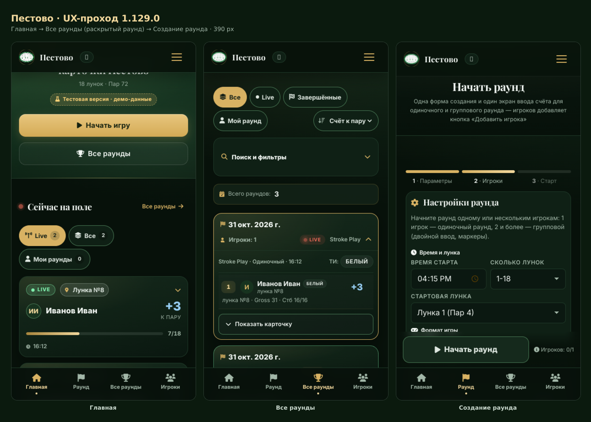

# Версия 1.129.0 — продуктовый UX трёх главных экранов

Редизайн-проход по `index.html`, `leaderboard.html` и `setup-round.html`:
главное действие на первом экране, читаемые числа, честные состояния.
Функциональность, маршруты, ID, классы и обработчики сохранены — новое
добавляется рядом, а не вместо.

## Что изменилось на экранах

### Главная

1. **«Сейчас на поле» поднят на первый экран.** Блок идёт сразу после
   компактного hero и выше «Последних результатов». Карта лунок и стартов
   (`#course-holes-strip`) переехала *под* живые карточки: вторичная
   информация больше не отодвигает раунды.
2. **Карточка live-раунда** собрана по одному сценарию чтения:
   статус + лунка → игрок(и) и счёт к пару → прогресс → время старта.
   В групповом раунде в свёрнутой карточке видна мини-таблица игроков
   (инициалы, имя, текущая лунка, счёт к пару).
3. **Счёт к пару — главный акцент** (28–36 px, `tabular-nums`, цвет из
   семантического токена и знак `−/E/+`). Gross остался в раскрытых деталях.
4. **Чипы фильтра** «Live / Все / Мои раунды» со счётчиками. По умолчанию
   активен «Live»: на поле показываются только идущие раунды, а созданные
   протоколом заранее (`status: scheduled`) честно помечены «Скоро» и видны
   во «Все».
5. **Клуб в цифрах** начинается с одной компактной полосы
   «3 раунда · 3 игрока · 3 берди · 2 сейчас играют»; десять подробных
   плиток спрятаны под «Подробные цифры» (`<details>`).
6. **Пометка демо-версии** «Тестовая версия · демо-данные» в hero.
7. **Онбординг на один экран** при первом визите: «Смотреть live»,
   «Начать раунд», «Таблица лидеров», «Пропустить». Показывается один раз
   (`localStorage: pestovo_onb_seen_v1`).

### Все раунды (лидерборд)

1. **Чипы фильтров** «Все / Live / Завершённые / Мой раунд». Они не заводят
   второй источник истины: три первых просто переставляют `#lb-status`,
   «Мой раунд» — дополнительное условие поверх поиска и дат.
2. **Сортировка по столбцу.** На десктопе — кнопки в шапке таблицы с
   `aria-sort`, на телефоне — компактный селект. Места (`1`, `T2`, …)
   по-прежнему считаются по счёту к пару: сортировка меняет только порядок
   строк, а не результат.
3. **Заголовки столбцов** укорочены (`Стб пол` / `Стб игр` вместо переносов
   по буквам), у столбца игрока выравнивание по имени.
4. **Мягкая зебра** и «липкий» столбец игрока на широком экране; на телефоне
   в строке остаются место, игрок и счёт к пару, остальное — в подписи.

### Создание раунда

1. **Индикатор шагов** «1 Параметры → 2 Игроки → 3 Старт» показывает реальное
   состояние: шаг закрыт, когда данные заполнены, а не по таймеру.
2. **Sticky-CTA «Начать раунд»** внизу экрана рядом с подсказкой
   «Готово к старту / Игроков: 1/2». Кнопка вызывает то же действие
   `startUnifiedRound`, что и кнопка в карточке.
3. **Inline-валидация.** Пустое имя и отсутствующий точный гандикап в
   одиночном раунде подсвечиваются у поля с текстом ошибки; ошибка снимается
   при вводе, фокус переводится на первое проблемное поле.
4. **Недавние игроки** — чипы под заголовком шага: имя подставляется в первое
   пустое поле одним тапом. Список копится локально
   (`localStorage: pestovo_recent_players`), в базу ничего не пишется.
5. **Дефолт времени** — ближайшие 5 минут, а не текущая минута.

Три экрана на телефоне — `docs/preview-ux-1.129.0.png`:



## Общий слой

| Файл | Роль |
|---|---|
| `css/theme-v2.css` | новые **семантические токены**: `--status-live/done/pending/scheduled`, `--score-under/over/par`, типографическая шкала `--fs-screen/player/score/note/micro-cap`, `--font-num`, `--tap`, `--tap-lg`, `--safe-t/b/l/r`, `--bottomnav-h` — тёмные и светлые значения |
| `css/product-ux.css` | компоненты на этих токенах: статус-бейджи, live-карточка, полоса прогресса, мини-таблица, чипы, полоса статистики, шаги, sticky-CTA, нижняя навигация, скелетоны, пустые состояния, сеть, онбординг, `prefers-reduced-motion` |
| `js/product-ux.js` | нижняя навигация (4 раздела), онбординг, честный баннер сети, подсветка изменившейся цифры, haptic на сетке счёта, шаги и CTA, недавние игроки |
| `js/app.js` | `pvLiveStatusHtml`, `pvRoundProgressHtml`, `pvMiniTableHtml`, фильтр `setHomeLiveFilter`, полоса статистики |
| `js/leaderboard.js` | `initLbChips`, `lbSetChip`, `lbSortBy`, `lbCompareRows`, `aria-sort` в шапке |
| `js/round-setup.js` | `setupValidateInline` и inline-сообщения об ошибках |
| `js/live.js` | дефолт времени старта — ближайшие 5 минут |

Порядок подключения CSS строгий:

```html
<link rel="stylesheet" href="css/style.css">
<link rel="stylesheet" href="css/theme-v2.css">
<link rel="stylesheet" href="css/product-ux.css">   <!-- новый слой -->
<link rel="stylesheet" href="css/design-presets.css"> <!-- пресеты побеждают -->
```

Все правила нового слоя адресуются через `body.pv-ux`, чтобы не конкурировать
с базой за счёт `!important`: `(0,2,1)` перебивает `(0,1,0)` `style.css`.

## Доступность

* Статусы не только цветом: у бейджа есть слово и точка/иконка,
  у счёта — знак `−/E/+` и `aria-label`.
* Видимый `:focus-visible` у всех интерактивных элементов.
* Ссылка «К содержимому» (`.pv-skip-link`) и `<main id="pv-main" tabindex="-1">`.
* Чипы — `aria-pressed`, шапка таблицы — `aria-sort`, сортировка доступна
  с клавиатуры.
* Тач-таргеты: 44 px у чипов, 48 px у действий нижней навигации и онбординга,
  56 px у sticky-CTA.
* `prefers-reduced-motion` отключает пульсацию LIVE, вспышку цифры и
  анимацию скелетонов.
* Safe-area: `--safe-b` учитывается в нижней навигации, CTA и онбординге.

## Проверки

```
node tools/run-tests.js --jobs=6      # + новый tools/test-product-ux.js (64 проверки)
node tools/test-product-ux.js
node tools/test-design-tokens.js
node tools/test-i18n-coverage.js
node tools/test-inline-handlers.js
node tools/check-round-setup-mobile.js   # 798 проверок, 5 видов формы
node tools/check-nav-mobile.js
```

## Ограничения (честно)

* **Синхронизации между устройствами нет** — это статический сайт с Firebase
  Realtime Database. «Нет сети» означает именно «запрос к базе не проходит»;
  счёт при этом кладётся в локальную очередь (`js/pwa.js`) и уходит при
  появлении связи. Баннер не обещает «сохранено в облаке», пока сервер не
  подтвердил запись.
* **Данные в скриншотах и проверках — демонстрационные.** Интерфейс помечен
  «Тестовая версия · демо-данные».
* **Сортировка на телефоне** — селект, а не клик по заголовку: шапка таблицы
  на узком экране скрыта, потому что в 390 px нечитаема.
* **Фильтр «Сейчас на поле» не влияет на блок «Активный турнир»** — это
  отдельная сущность, а не срез списка раундов.
* Список «недавних игроков» живёт только на устройстве: без бэкенда его
  нельзя синхронизировать, поэтому он и не притворяется общим.
